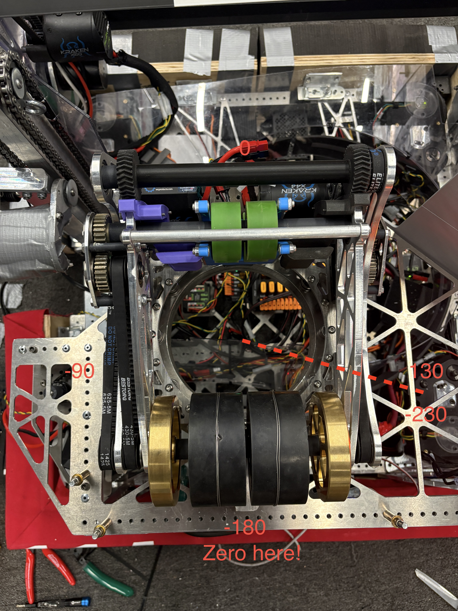
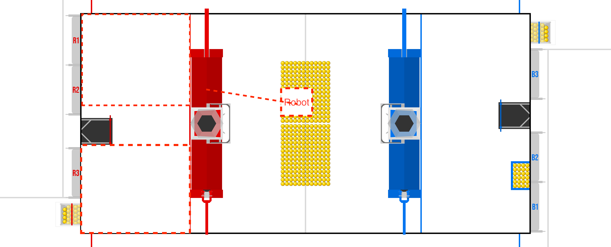

# 2026 Robot Code

## Shooter Turret

<em>Figure: Turret coordinate system.</em>

## Ferrying

<em>Figure: Ferrying Example</em>

We want the ball to go in one of the two zones marked by the red dashed line. To do so, we set the target to be above the trench / bump so that following the parabolic arc, the ball falls into the desired zone (let's not ferry over the hub because that significantly reduces range).

***Default Value for Harmonic Drive (from Jerry Robotics Arm)***  

  KS = 0.19 (or 0.2095)   V  
  KV = 3.0                V·s/rad  
  KA = 0.01 (or 0.0)      V·s^2/rad  

  KP = 40.0               V/rad  
  KI = 100.0              V/(rad·s)  
  KD = 1.2 (or 0.7)       V·s/rad  

  IZONE_DEG = 0.2 (or 0.1)          degree  
  I_MAX_VOLTS = 1.0 (or whatever)   V  

kP 40
kI 100
kD 0.7
izone_deg 0.2
i_max_volts 1

kS 0.19
kV 3
kA 0.01
kGCos 0.05

max vel 6
max acc 12